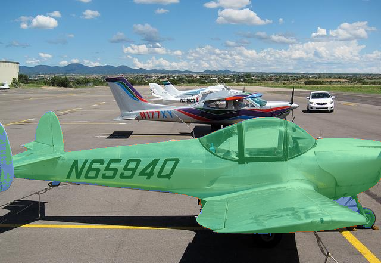

# Local text-to-mask results on Spark — 22 October 2026

**Subsequent VSS deployment:** the fixed resident service is now running and
selected for VSS startup. Defense and Smart City have a working Local vision
inspector. See [startup, coexistence, UI tests and actual screenshots](vss-integration.md).
The measurements below preserve the preceding standalone comparison.

**Recommended tested route: stock Photon Moondream2 `point` → SAM2.1 Tiny.** Moondream supplies a point for the requested object. SAM turns that point into a pixel mask. Moondream's independent `detect` and `describe` functions remain available. This is a working two-model pipeline; it does **not** fix native Moondream `segment`. The [native segmentation investigation](../moondream-spark-2026-10-22/advertised-segmentation/upstream-evidence.md) records that separate limitation.

We executed three complete pipelines on the local Spark GB10. The newest run made 40 segment calls: ten image/prompt cases, presence checking off or on, and two repeats per mode. Only three cases have ground-truth masks. Three further positive examples are qualitative; four cases test absent objects. These are smoke tests, not a defense validation set.

## Measured results

IoU is the overlap between the returned mask and the annotated target. For multiple returned objects we measure their union, without choosing the best object using ground truth.

| Pipeline | Person IoU | Cat IoU | Front aircraft IoU | Second-repeat positive request time, presence off | Peak CUDA allocator reserved |
|---|---:|---:|---:|---:|---:|
| Moondream2 **box** + EdgeTAM | 97.14% | 97.93% | 72.51% | 345–6,294 ms | 4.842 GiB |
| Moondream3 Preview **box** + SAM2.1 Tiny | 93.87% | 98.52% | 97.61% | 1,143–2,058 ms | 17.350 GiB |
| **Moondream2 point + SAM2.1 Tiny** | **96.82%** | **97.81%** | **96.26%** | **334–693 ms** | **4.961 GiB** |

The recommendation favors the balance of speed, memory and quality observed here. It is not a controlled attribution to one model change: the first and third runs change both the grounding method and mask model. Preview also uses our GB10 Torch MoE compatibility path. Stock Photon Moondream2 still reports Torch fallbacks for some kernels on SM121; it is not fully optimized native inference.

The old Moondream2 box run generated up to 50 detections before slicing to three. Its six-second warehouse result includes that obsolete limit bug. Later runs apply the actual spatial generation limit of three. Its aircraft result also includes three returned masks: the first mask scores 84.35% and the other two do not overlap the intended front aircraft. We did not hide those outputs by selecting the best mask.

In the recommended run, all eleven positive calls after the first mask load took **334–1,017 ms** with presence checking off. The narrower table range reports only the second repeat. All four absent-object cases returned no points and no masks in both repeats with checking off. Query checking answered “no” in those cases but added latency to positives without improving these results. We therefore recommend **presence off for this tested point route**, subject to validation on the intended footage. An older “cat image / no person” case is excluded from absence claims because a partial hand is visible.

## Cold start and memory

For the recommended run, Moondream loading took **25,481 ms**. The first detection including that load took **25,865 ms**. After Moondream was already loaded, the first mask request took **1,591 ms**, including **826 ms** to load SAM. These are distinct measured operations, not a measured single cold segment request. A separate point call took **292 ms**; one description took **3,767 ms**.

Maximum observed CUDA allocation was **4.462 GiB**, peak allocator reservation **4.961 GiB**, and minimum system `MemAvailable` **50.775 GiB**. Allocator memory is not total process memory or a complete unified-memory measurement. The saved 20 GiB reserve remained in force.

For comparison, the old Moondream2/Edge run loaded Moondream in 25,714 ms and first mask in 1,641 ms (672 ms mask loading). Preview/SAM loaded Moondream in 62,251 ms and first mask in 2,393 ms (959 ms mask loading). Their minimum available system memory was 51.121 GiB and 34.139 GiB respectively. Full measurements and hashes are in [end-to-end-summary.json](end-to-end-summary.json).

## Actual output



**Green:** correctly included target pixels. **Orange:** extra pixels. **Blue:** missed target pixels. The front-aircraft example scores **96.26% IoU**. Moondream supplied normalized point `[0.63671875, 0.64453125]`. SAM chose one of three candidates by its own predicted score, not by ground truth. The [binary mask](md2-point-sam2-tiny-aircraft.mask.png) and overlay are byte-identical copies of the run outputs. Their SHA-256 hashes and fixture provenance are recorded in the summary JSON.

## How to use this result

Use the settings below. They are also the CLI defaults; the lower-level bridge
retains `detect` as its default, so Python callers must select `grounded_by="point"`.

```bash
.spark/moondream-photon/venv/bin/python tools/segmentation/run.py \
  --task segment \
  --image /absolute/path/image.jpg \
  --object "plane in front" \
  --model moondream2 \
  --segmenter sam2.1-tiny \
  --grounded-by point \
  --presence off \
  --output-dir /absolute/path/new-result
```

See the [implementation instructions](../../../tools/segmentation/README.md) for staged weights, dependencies and memory guards. The [subsequent CLI verification](cli-receipt.json) reproduced the exact benchmark aircraft mask. Two resident requests took 618.47 and 618.38 ms, excluding separate PNG/overlay writes; peak CUDA allocator reservation was 4.949 GiB. All 33 CPU tests and `pip check` passed.

The [restoration receipt](runtime-restored.json) confirms Cosmos is healthy with
HTTP 200, the memory guard is active, and the saved reserve remains 20 GiB.
The new pipeline is available through the local CLI and Python API; no new
inference server was left running and no VSS UI integration was changed.
Concurrent Cosmos/Moondream execution remains unqualified. The CLI conservatively
requires 50 GiB available with the current reserve, so Cosmos must currently be
stopped temporarily before using it; the CLI does not stop other services itself.

Existing RF-DETR boxes can feed the mask adapter directly and skip Moondream grounding. The earlier [mask-only comparison](comparison.md) measured SAM2.1 Tiny case medians of **39.3–80.7 ms**, versus **24.1–31.0 ms** for EdgeTAM. EdgeTAM remains an option when mask speed matters more than boundary quality. Those times are a mask stage, not a full text request or proof of 30 FPS whole-frame processing.

These runs do not establish video tracking performance, simultaneous stream capacity, Thor performance, p95 latency, or accuracy on military scenes. The benchmark resized inputs to fit within 1024 × 1024 with aspect ratio preserved. The CLI and Python bridge instead preserve input size and accept up to 16 megapixels; those larger inputs are not qualified by this test. Two repeats per case cannot establish a stable latency distribution. The next validation should use the actual camera views, target classes and absent-object cases from the intended demo.
