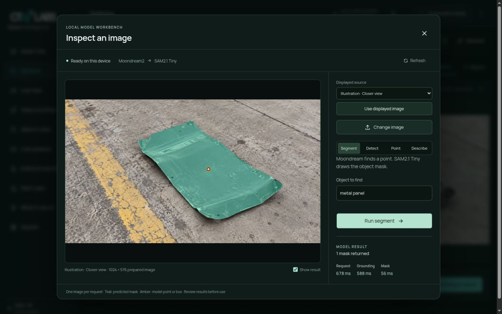
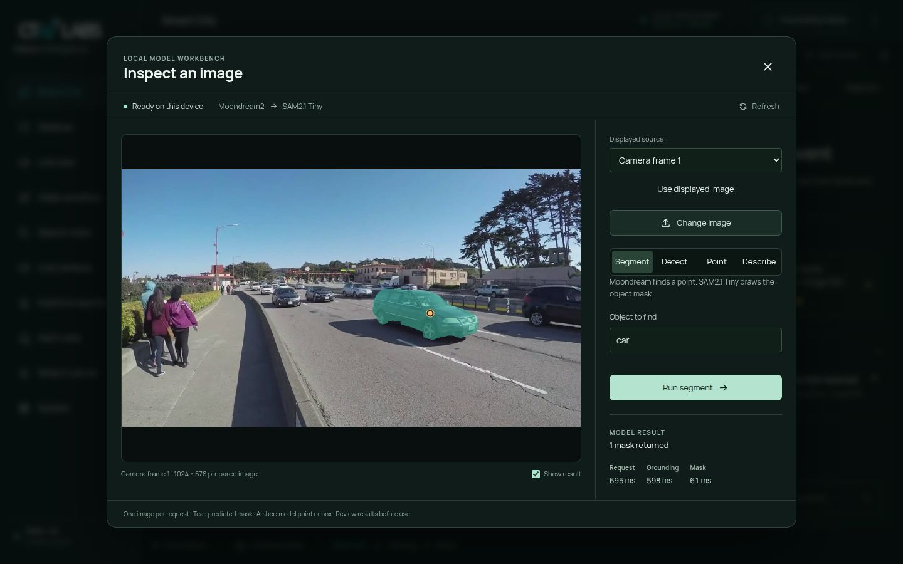

# VSS local vision: deployed on Spark

Executed 22 October 2026. The selected VSS configuration now starts a shared
**Moondream2 through stock Photon + SAM 2.1 Tiny** service. Both Defense and Smart
City expose it through **Local vision**. This is the working hybrid pipeline;
Moondream's native segmentation skill remains unresolved.

## What is deployed

- `vss-spark-local-vision.service` reuses the staged virtual environment and
  checkpoints. Both models warm before `/ready` succeeds. The observed warmup
  was 30.42 seconds.
- Spark `bootstrap up` and desktop **Start VSS** start the selected worker;
  stop/down and desktop **Stop VSS** stop it. Warm startup reuses the models and
  recreates only the UI if its private connection settings changed.
- The fixed service listens on `127.0.0.1:8026`. The Next.js proxy keeps its
  token server-side. Images are explicitly fitted to 1024 pixels on their
  longest side; requests are serialized with a three-object limit.
- **Segment**, **Detect**, **Point**, and **Describe** process a captured displayed
  frame or uploaded image. Masks, points, boxes and answers are actual model
  output. This is requested-image inference, not a new continuous analysis rule.

The saved reserve remains **20 GiB**. The new profile requires another 12 GiB at
startup and stops itself below reserve + 3 GiB or on guard loss. The active guard
also stops this host worker independently of Docker and telemetry writes. The
guard was restarted to load that handling; Cosmos remained healthy.

## Executed checks

| Check | Result |
|---|---|
| Automatic startup/lifecycle and regression tests | 138 CPU tests passed |
| UI/proxy regression checks | 6 suites, 30 tests passed |
| Strict app TypeScript check | Passed |
| VSS runtime verification, including local model readiness | No failed probes |
| HTTP qualification | 13 recorded checks passed |
| Simultaneous Cosmos visual answer and local segmentation | Both HTTP 200 |
| Busy worker | Second inference rejected with 429; health remained responsive |
| Missing model token | Inference rejected with 401 |
| Annotated person/cat/aircraft masks | IoU 96.82%, 97.81%, 96.26% |
| Blank control | No points or masks |
| Browser console | No errors or warnings in checked flows |
| Memory and host | Minimum 31.35 GiB available; boot ID unchanged; no reserve trip |

The three annotated targets reproduce the earlier masks. This is a small sanity
check, not a defense accuracy benchmark. The HTTP image requests took 355–983 ms
for these positive segmentation examples; one description took 4.48 seconds.

## Browser flows

**Defense:** Drone inspection → Inspect → Local vision → Illustration · Closer
view → Use displayed image → `metal panel` → Segment. The real returned mask was
displayed on the illustrative source. Browser request: **678 ms**; model grounding:
588 ms; image encoding/mask decoding: 56 ms. The illustration label remains visible.

**Smart City:** Local vision → Camera frame 1 → Use displayed image → `car` →
Segment. The input was a frame from the existing recorded RTSP replay. The
returned mask outlined a visible car. Browser request: **695 ms**; grounding:
598 ms; image encoding/mask decoding: 61 ms. A subsequent Describe request after
the guard/service restart displayed a real model answer in 3.90 seconds.

Browser testing used the available unified computer-use browser controls. No
separate browser plugin was listed. Desktop screenshots were 1425×891 and
1440×900. Mobile and other browsers were not tested.

## Evidence and scope

[Structured receipt](vss-integration.json) contains readiness, memory samples,
source hashes, HTTP responses and screenshot hashes. Detailed test logs and
one-second memory telemetry remain under
`.spark/local-segmentation/service-qualification-20261022/`.

The initial unit's quoted WorkingDirectory directive was rejected by systemd;
it was corrected and is now checked with the actual systemd parser. A worker
also stopped unexpectedly during the early restart/test session; its caller was
not proven. An existing detector test was found able to reach real lifecycle
calls, so lifecycle tests now mock these calls and reject unmocked service
mutations. The final full CPU suite passed while the worker was running. Cosmos
remained healthy throughout these corrections.

The service is left running and selected for future VSS startup. Existing
Cosmos, RF-DETR and simulation configuration were retained. No full Docker-stack
cold restart, continuous-stream capacity test, Thor deployment or model-accuracy
certification is claimed. Reproduction and lifecycle details are in the
[implementation README](../../../tools/segmentation/README.md).

