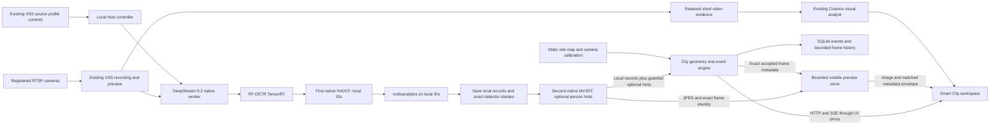

# Smart City VSS: implemented system and qualification

**Current rebuild — October 26, 2026; bounded booth implementation accepted.** Open [Smart City](http://127.0.0.1:7782/?workspace=smart-city). The running, hash-pinned scene is `pedestrian-pocket-v3/smart_city_expo_pedestrian.usda`. It inherits the smaller 1,826-mesh neighborhood and reviewed daylight look, moves one southwest building five metres west and adds a two-triangle paved waiting strip. Original assets, roads, navigation and protected analytics cameras are preserved. Four static captures passed bounded visual review; rear-building overlap remains a full-view/temporal review limit. A fresh cold LOAD completed in 74 seconds; all eight people showed accepted native motion and more than 0.5 m observed displacement over 40.819 wall seconds. This is startup evidence, not a complete crossing or failure-free choreography score. [Current setup checkpoint](qa/smart-city-2026-10-26/v3-setup-checkpoint.json), [goal ledger](smart-city-intersection-goal-2026-10-26.md).

The two NVIDIA native H.264 cameras retain **960×540**, the existing relay and VSS registrations. **RF-DETR Medium FP16 / DeepStream 9.2** remain selected. Native image `sha256:4e6b73d1b19e133680a583d5d2f109e20a6953537adea1165b7a381abf42c3dd` and profile `cadd8867c22388c78066d9f0dac4b35e240d5512bc84a6b5e36446957dd9a1dd` preserve eight tracker pins, **19 rules now acknowledged at revision 450**, mobility revision 6 and calibration `isaac-live-045c84fe5fda7a15`. First-stage **NvDCF** owns camera-local journeys and analytics; second-stage **MV3DT** supplies optional guarded person-map hints. Counts, vehicle identities and rule state remain camera-local. Temporary diagnostics and mux synchronization remain off with latency/NTP window zero. Operational analytics use image observations; simulator IDs remain separate evaluation data.

The isolated production UI is package `20261026T102610382036Z`, image `sha256:1d94d0350f90c2e4f120f0295553e6ed06d6b71789579378bf532a634605fc0f`, source `d4aee494f102dc2a60782060735fc22a879b5313cf5f140ea79543868ed0e25f`. Ten build tasks passed in **2 m 4.333 s**. It repairs the public proxy's removal of native source-clock proof without changing the accepted layout, branding or map asset (`c4d14670c7be4dea04b4d29f9bd3e252681c11ff00da92568456781c261e1a70`, 1040×1120), whose served HTTP bytes match the final health receipt. The final native/UI installation retained the same scene and publisher, admitted new source sessions normally and kept current recordings ready; the CPU gateway was **not restarted** in that final cutover. Both exact analyzed views rendered in the actual browser sample. [Proxy repair](qa/smart-city-2026-10-26/native-capture-clock-proxy-repair.json), [immutable UI build](qa/smart-city-2026-10-26/native-capture-clock-proxy-ui-build.json), [restart/rollback](../tools/smart-city/UI-PACKAGING.md).

**Earlier pre-clock-repair evidence repairs:** after two source-scoped pauses, only the CPU gateway was restarted and the same sources resumed normally. The three loaded backend hashes are engine `aff5a638…`, mobility `d4bb65c3…` and spatial `04425575…`; readiness confirms all **19 rules at revision 434**, mobility revision 6 and unchanged native profile `55a3297a…`. Bounded stopped-zone pending proof excludes unobserved time, and pedestrian exits require two fresh same-identity observations within the original one-second bound. Outside anchors remain outside occupancy. Combined city CPU checks passed **259/259**; independent pending-label UI checks passed **49/49**. [Deployment and actual-camera checkpoint](qa/smart-city-2026-10-26/v3-evidence-repairs-checkpoint.json), [pedestrian source/replay limits](qa/smart-city-2026-10-26/pedestrian-pending-exit.md).

The earlier pre-clock-repair **People wait, cross, and clear** UI episode passed in **97.123 wall seconds**. Native task status was **SUCCEEDED**, the measured three-dimensional landing error was **0.03796 m**, the person was outside the crossing, and the normal program was restored. Independently, the Southwest camera's **East north-to-south** completed counter advanced **0→1**. This is one full native episode plus a camera-local far-side traversal, not an identity-accuracy score or a guarantee for every click. First-seen approach time remains a lower bound, excluded from full wait samples; it is not signal delay or the scenario timer. [Full native/camera receipt](qa/smart-city-2026-10-26/v3-final-pedestrian-live-ui.json), [actual rendered result](qa/smart-city-2026-10-26/v3-final-pedestrian-completed.jpg).

That earlier native episode used source pins people `836ed862…`, scenario runtime `0cf9ee68…` and director `f8a760c8…`. Native free-point selection stays inside the unchanged waiting pads and retains WALK/path/arrival guards. The same-entry reapproach did **not** trigger in this successful episode; its focused controls and reviews are separate. The earlier cancelled landing at 133.844 seconds, waiting-drift failure at **41.344 seconds** and WALK-deadline failure at **107.976 seconds** remain preserved. An earlier south-to-north camera traversal also remains separately recorded; rolling opposite-direction/lost-track evidence is not erased to make a clean total. [First retry failure](qa/smart-city-2026-10-26/pedestrian-free-endpoint-first-live.json), [deadline failure](qa/smart-city-2026-10-26/pedestrian-walk-deadline-first-live.json).

The earlier pre-clock-repair **Keep the crossing clear** UI episode completed and restored in **34.299 wall seconds**. Its actual camera alert went active then cleared, with **12.114 observed blocked seconds, one completed episode and zero unknown episodes**. This qualifies that single scene/AI sequence on the paired simulated-camera system; it is not exhaustive accuracy or general production acceptance. [Pinned scene/AI receipt](qa/smart-city-2026-10-26/v3-repaired-crossing-live-ui.json).

The earlier pre-clock-repair curbside-lane episode completed and restored in **42.040 wall seconds**. Actual camera measurements showed occupancy, a stopped condition and the configured eight-second dwell. The curb row reported maximum active observed dwell **23.093 seconds**, **17.511 observed stopped seconds** at the end, a departure counter change **2→3** across the observed exit, and final status empty with zero observed occupancy. These are row/window measurements, not proof of a legal loading purpose or a parking offence. [Curb scene/camera receipt](qa/smart-city-2026-10-26/v3-repaired-curb-live-ui.json).

The earlier normal-demand episode completed in **30.031 wall seconds**, verified normal flow and requested no extra arrivals; this short window does not promise every turn or road-user class. A separate actual UI cancel released a car that had been held at **0 m/s**. Its native route coordinate subsequently advanced **3.470 metres**, with sampled speed **4.158 m/s**. The held queue image independently showed at least two currently observed objects and an **11.2-metre lower-bound extent**, but queue clearance was not confirmed. [Demand receipt](qa/smart-city-2026-10-26/v3-demand-live-ui.json), [actual cancel/motion receipt](qa/smart-city-2026-10-26/v3-ui-cancel-motion.json).

The earlier full queue control passed in **36.014 wall seconds**, with a real hold, normal release, observed native head departure and restored normal flow. The camera separately observed **two queue objects with a 9.535-metre lower-bound extent** around 19 seconds. Its peak row was a candidate and later membership was incomplete; this is not a qualified empty-queue or clearance result. [Final queue scene/camera receipt](qa/smart-city-2026-10-26/v3-final-queue-live-ui.json).

These earlier individual scene checks retain their original native/UI identities and are **bounded functional evidence**, not a new endurance result. The [earlier scenario checkpoint](qa/smart-city-2026-10-26/v3-bounded-scenarios-checkpoint.json) pins those receipts. On the final native-SEI artifacts, the new pedestrian episode completed/restored in **42.7099 wall seconds**, native endpoint task **SUCCEEDED**, landing error **0.03830 m**, outside the crossing. Camera completion remained **0→0** and incomplete remained **3→3**: those three were already present when observation started, not three new failures from this episode. The same local camera ID persisted, but fresh-object observation gaps of **1.137 s and 1.871 s** exceeded the unchanged one-second evidence bound. Thus this native success has **no qualified current camera completion**; the old 97.123 s / camera 0→1 pass stays separate. [Current native/camera result](qa/smart-city-2026-10-26/native-sei-final-pedestrian.json). [Read-only continuity audit](qa/smart-city-2026-10-26/native-sei-pedestrian-camera-continuity.json) confirms camera frames continued; the cause of target-specific observation loss was not visually isolated. Final health passed. The bounded booth prototype is accepted with the stated evidence limits. The October 22 replay soak does not qualify the changed scene/tracker/UI.

**Current native-SEI rates:** the server sample passed **29.9868 seconds**; the actual browser counter sample ran **57.82 seconds** separately.

| Measurement | Southwest FPS | Northeast FPS | Sample |
| --- | ---: | ---: | --- |
| Native camera handoff | 9.403 | 9.403 | 29.9868 s |
| Accepted observations | 9.404 | 9.437 | 29.9868 s |
| Published exact previews | 9.371 | 9.371 | 29.9868 s |
| Selected processed frames | 9.166 | 9.184 | 57.82 s |
| Actually rendered frames | 9.011 | 9.132 | 57.82 s |

The native sample checked **22 exact image/metadata envelopes** and six stable container identities; simulation advanced at **0.3134× wall rate**. Browser views kept their sessions and reported exact-frame alignment. These distinct short windows do not isolate stage cost, establish a speedup or measure physical capture-to-display latency. [Current native/server receipt](qa/smart-city-2026-10-26/native-sei-final-native-performance.json), [current browser receipt](qa/smart-city-2026-10-26/native-sei-final-browser-performance.json).

**Current clock and map evidence:** `source-native-sei` uses the producer's encoded-AU wall-handoff timestamp, correlated by exact AU PTS **before both trackers**. The same six-field proof survives ordinary JSON and exact previews; generic cameras retain RTCP. All **11/11** sequential latest-snapshot pairs were inside the unchanged **150 ms** display guard: **0.501168 ms median / 123.68622 ms maximum**. Retained current-session observations supplied **83 initially guard-eligible pair updates**, including **45 with the same native render counter**. That is conditional offline guard evidence. Separately, the actual browser accessibility state reported **“Shared person · 2 views” / “1 joined”**, and the [final dashboard pixels](qa/smart-city-2026-10-26/native-sei-final-dashboard.jpg) show **“Experimental shared people IDs · 1 joined”**, both AI-live views, markers and movement counts. The older `native-sei-shared-person-browser.jpg` showed zero at its screenshot instant and one in subsequent accessibility state; do not conflate that older pair or claim every frame joins. These are bounded handoff/transport/display results, **not independently labelled physical-person accuracy**, physical exposure synchronization or global counts. Existing position, model, calibration, session and visibility guards remain, and `browserClockVerified` remains false. [Paired evidence and browser distinction](qa/smart-city-2026-10-26/native-sei-qualified-shared-pair.json), [clock contract](smart-city-data-contracts.md).

**Current Ask:** one actual Southwest question about the last five seconds returned an answer and an inspected **5.0304-second** clip that played to its end with no media error. On-demand indexing remained inactive; this is not sustained visitor-load or VLM accuracy qualification. Structured counts/events remain authoritative. [Actual question/playback](qa/smart-city-2026-10-26/native-sei-final-ask-browser.json).

**Pre-clock-repair v3 rates — historical:** the native/server sample ran **30.063 seconds**; a separate partly overlapping browser sample ran **44.073 seconds** at 1920×1080.

| Measurement | Southwest FPS | Northeast FPS | Sample |
| --- | ---: | ---: | --- |
| Native camera handoff | 10.120 | 10.120 | 30.063 s |
| Accepted observations | 10.145 | 10.112 | 30.063 s |
| Published exact previews | 10.046 | 10.012 | 30.063 s |
| Selected processed frames | 10.210 | 10.233 | 44.073 s |
| Actually rendered frames | 9.643 | 9.757 | 44.073 s |

The native sample validated **22 exact image/metadata envelopes** and six unchanged container identities; simulation advanced at **0.337× wall rate**. The browser receipt reports exact-frame alignment for both cameras. These different windows do not isolate a stage cost, establish a speedup, or measure absolute capture-to-display latency. [Native sample](qa/smart-city-2026-10-26/v3-final-native-performance.json), [browser sample](qa/smart-city-2026-10-26/v3-final-browser-performance.json), [scoped summary](qa/smart-city-2026-10-26/v3-final-performance-summary.json).

**Preserved pre-repair clock failure:** the earlier eleven latest-snapshot pairs had **597.073 ms median / 597.315 ms maximum** skew, with **0/11** inside the unchanged 150 ms guard. Shared joins were correctly rejected. Subsequent wire evidence identified the worker's RTCP reconstruction as the bad mapping; the explicit native AU proof supplies the new authority without timestamp subtraction or relaxed thresholds. Intermediate native image `54b13c…` / UI `77c066…` also exposed a missing native-basis publisher gate and stripped nested proxy proof. Their failures and immutable artifacts remain preserved; they are not relabelled as final acceptance. [Proxy failure/repair](qa/smart-city-2026-10-26/native-capture-clock-proxy-repair.json), [native hint-gate failure](qa/smart-city-2026-10-26/native-sei-hint-gate-failure.json).

**Earlier v2 integration:** an independently detected stopped-junction event became active then cleared during a completed vehicle episode; a native pedestrian episode completed in 97.67 wall seconds; the normal-demand observation completed in 30.11 seconds. A real two-minute indexing session produced 24 indexed documents, returned six scoped search matches, played a retained clip and stopped indexing while both CV sources remained active. A separate five-second Ask clip loaded and played to completion after the Agent evidence route was repaired. These results do not yet qualify every final scenario: the queue run used the earlier eastbound route, the pedestrian run did not establish an AI completed-crossing count, and the curb run exposed normal pedestrian traffic blocking the road. The original failure receipts are preserved. See [bounded indexing](../tools/smart-city/BOOTH-INDEXING.md), [actual Ask evidence](qa/smart-city-2026-10-26/live-ask-browser.json) and the goal ledger.

**Earlier v2 normal-flow evidence:** signal-aware normal walking and its native end-cap recovery passed a separate **180.17-wall-second** observation. Two new WALK-gated crossings and one crossing already active at the start reached far-side continuation; two native curb reapproaches also completed. No new native failures, rejects or timeouts appeared in any of the eight walkers' counters. Earlier counters remain retained. This is native choreography evidence, not an AI crossing score or full-cycle fairness study. [Normal-flow receipt](qa/smart-city-2026-10-26/normal-flow-live-acceptance.json).

The earlier v2 northbound queue scene control completed in **51.93 wall seconds**. Live AI evidence showed up to **two stopped queue objects**, estimated extent **10.98 metres** and a reached measurement boundary. The owned stop was released, but the queue still existed under the normal red at the control endpoint. This is actual queue formation evidence, not an AI queue-clear receipt. Follow the subsequent normal signal and read clearance independently. [Active queue image](qa/smart-city-2026-10-26/queue-final-active.jpg), [scene/UI trace](/home/sparkdev/isaac_city_sim/logs/vss-integration/rebuild-20261026/scenario-queue-final-early-ui.ndjson).

Earlier v2 worker clock diagnostics compared **317 frames per camera** at depay, parser, decoder and pre-mux stages. SDK NTP agreed with the same-buffer RTCP reference within **3.555 microseconds absolute** in that cohort. The earlier persistent 450 ms difference was absent after the diagnostic restart, before mux synchronization settings changed. Its historical cause is not established. This verifies that measured mapping; it does not prove physical exposure synchronization or browser latency. [Actual worker proof](qa/smart-city-2026-10-26/source-clock-actual-worker-proof.json).

**Final health and bounded booth acceptance passed.** The [final health receipt](qa/smart-city-2026-10-26/native-sei-final-health.json) verifies 19 rules/450, mobility 6, eight pins, unchanged calibration, HTTP map hash, current recordings, inactive indexing, all five stories available and normal restoration. Availability is not a new execution of every story. Current native-SEI transport, exact previews, bounded browser rates, actual shared-person pixels and one real Ask/clip playback have scoped evidence above. The latest native pedestrian result lacks a qualified camera completion for the documented observation-gap reason. Prior scene passes retain their original scope, and the rejected PTS, 597 ms and intermediate failures remain preserved. No fused site count, production identity accuracy, booth-day endurance or Thor runtime result is claimed.

The dated sections below preserve model decisions and earlier qualification. Their historical runtime statements do not replace the current rebuild status. Long live endurance remains deferred at the user's request; current verification uses focused CPU checks and bounded real integration runs.

## What is implemented

The existing VSS application has an additional Smart City workspace and a two-source analysis profile. It retains the CT AI Labs shell, camera inventory, recording services and visual analyst. Cameras, analysis profiles, site calibration and device deployment remain separate so later industry workspaces can use the same VSS services.

The workspace contains two camera panes, detection and rule overlays, a calibrated map with object selection and trails, editable polygons and directed lines, and Now / Insights / Ask / Reports panels. The Isaac site adds an actor-free overhead image registered in metres. Recorded playback and its observations share a timeline. Reports use durable site history; they do not claim that the currently visible events are the complete history.

Live overlays require the exact source frame. The native analyzed-preview path pairs a JPEG and its original observation identity. The October 22 native GPU path, preview-endpoint failure isolation, production UI cutover and rendered image/overlay checks passed, with [image/source/browser receipts](qa/smart-city-2026-10-22/ui-final-production.json). That configuration also passed [two-hour Spark replay qualification](qa/smart-city-2026-10-22/medium-final-all-ui-summary.json). Raw WebRTC remains a fallback and needs independent browser/source clock verification before overlaying boxes. An RTCP timestamp alone does not enable those raw-video overlays. Uncalibrated observations have no map position. The earlier independent traffic and pedestrian clips demonstrated real detection and rules, while separate labelled fixtures demonstrated shared geometry. The current Isaac site supplies actual shared geometry and two live image sources; historical integration tests and the sprint's pending qualification are distinguished below.

## Actual data path

The city observation path uses local HTTP and SSE. It does not require a new Kafka, Redis, map server or separate camera registry. Existing VSS infrastructure continues serving its other functions.

The native worker uses per-source decode, bounded queues, `nvstreammux`, GPU conversion and exact RF-DETR preprocessing, `nvinfer`, first-stage native CUDA NvDCF, `nvdsanalytics`, then second-stage native MV3DT. First-stage local records remain authoritative if optional second-stage evidence is absent or its global ID changes. Missing or ambiguous stamps fail closed for optional associations. Spark uses software video decoding followed by a GPU upload; this is not an end-to-end zero-copy claim. A bounded observation publisher reports overload or delivery failure instead of silently discarding frames. The PTS-sync startup candidate was rejected. The current profile keeps mux synchronization disabled; its final bounded FPS sample is recorded above, while cross-camera timing and reconnect/field robustness remain separate limits.

The host controller owns the native worker and provides the CV interface expected by the existing Agent. HTTP analytics containers have no Docker socket. Source add, pause, resume, removal and capacity admission go through the existing Agent source APIs.

## Models and measurements

| Component | Implemented choice | Qualification boundary |
| --- | --- | --- |
| Detector | RF-DETR Small 512 and Medium 576, `rfdetr==1.11.2`, FP32 model I/O with an FP16-enabled TensorRT engine | Both actually exported, built and tested on Spark. Medium is selected and passed the two-hour combined replay run; Small is retained as the tested lower-cost alternative. |
| Tracker | First native NvDCF for local IDs and analytics; second native MV3DT for optional shared hints | Deployed with explicit same-frame local/global provenance. Rules/counts remain camera/session-local. Guarded shared-person map hints are experimental; final-intersection tracking accuracy remains unqualified. |
| Zone primitives | DeepStream `nvdsanalytics` | Native geometry reloads are acknowledged by revision. The city engine remains authoritative for class-filtered event state and duration. |
| Questions | Existing Cosmos3 Nano NVFP4 VSS endpoint | With the Medium detector active, seven sequential five-second questions completed during the two-hour run at 15-minute intervals. Earlier evidence and limited visual reviews found prose errors. This is operational qualification, not exhaustive counting or semantic accuracy. The one-frame path remains unqualified. |
| Semantic indexing | Existing Cosmos Embed service | Reused through normal VSS source controls. |
| Overlapping-camera map hints | Experimental MV3DT person association on the actual paired intersection streams | Active for guarded shared-person display only. Production fusion failed the saved gates; operational rules, counts and vehicle identities remain camera-local. See the current demo guide. |

The detector comparison used the same fixed, class-stratified 100-image COCO road-user subset. It is a paired engineering comparison, not full COCO AP or final elevated-camera accuracy. The table records the original postprocessing before the October 23 query policy below.

| Actual Spark FP16-enabled engine, batch two | Six-class AP50:95 | GPU compute p50 / p95 |
| --- | ---: | ---: |
| RF-DETR Small | 55.884 | 8.247 / 9.047 ms per batch |
| RF-DETR Medium | 57.803 | 9.423 / 12.382 ms per batch |

Engine timing excludes decode, tracking, transport, display and questions. These serial engine tests had Cosmos and Embed loaded but idle and the Spark LLM stopped. Separate native pipeline checks ran with the normal model services loaded: both models passed five-minute mixed-rate RTSP checks. Medium's highest reported source-clock age was 0.404 seconds. These values are not browser capture-to-display latency.

Medium's approximately 1.92-point AP advantage and modest engine cost justify the current preference. They do not establish that every possible detector was evaluated. NVIDIA's four-class traffic baseline was staged but needs its custom TensorRT plugin and lacks separate bus/truck labels. RT-DETRv4-M weights could not be obtained through the trusted available download paths. YOLO26 remains conditional on company deployment terms. See [exact challenger state and receipts](../tools/smart-city/CHALLENGERS.md).

The current worker keeps **one highest-scoring supported city class per RF-DETR query**, after the reference global query/class top-300 selection and city-class filter. Different queries are not spatially merged. This prevents one query from becoming several competing class detections; it does not guarantee one detection per physical object. The policy is recorded in observation model identity as `postprocess=one-city-class-per-query-v1`.

[Paired CPU rescoring of cached TensorRT outputs](qa/smart-city-2026-10-23/sprint-query-policy-comparison.json) changed six-class AP50:95 from **57.803 to 57.681**, a **0.122 percentage-point decrease** on the same 100-image subset. Small-object AP increased from 35.957 to 37.353; coarse road-class AP was effectively unchanged (56.700 to 56.706). This is an explicit object-counting tradeoff, not a claim of an overall detector accuracy gain. A drum misclassified as a road user and bus/truck confusion remain observed limitations. The policy does not retrain the model or fix those fine-class errors; final live tracking and event qualification remain separate.

The later [explicit five-second question check](qa/smart-city-2026-10-22/medium-paired-five-second-semantic.json) returned in 9.37 seconds, with a matching 150-frame, five-second evidence clip. Review of the decoded first and near-final frames found broadly consistent traffic and pedestrian movement. The answer mentioned three pedestrians while a fourth became visible near the end. This is a limited qualitative check, not a counting score or semantic benchmark. A separate one-frame request had described a purple image; its exact failure cause remains unresolved. The Smart City request explicitly uses five seconds, without changing global model or decoder settings.

## Rules, geometry and evidence

The six detector classes are person, bicycle, car, motorcycle, bus and truck. Seven event families are implemented: area entry, directed line crossing, occupancy threshold, dwell, stopped in zone, queue and wrong way. Metric speed conditions require qualified calibration; image-space occupancy and crossing can work without a ground map.

The running Isaac scene supplies an actor-free static map, common metre coordinate frame, actual decoded image geometry, homographies and valid ground regions. Vehicles use the road plane at −0.2 m; people use the static navigation-plane median at 0.02875 m. The backend projects the bounding-box bottom centre, rejecting invalid or out-of-region positions. This estimates a ground anchor; it does not establish an exact vehicle centroid, measured vehicle speed or collision distance. Simulator actor IDs and scripted incident times do not drive operational observations or rules.

Events retain source/session/local identity, rule and calibration revisions, model identity, onset and activation times, and evidence timing. Recorded events can seek matching video and observation history. The pinned current Isaac profile uses explicit native SEI encoded-AU wall-handoff time with exact PTS proof; generic cameras keep their declared RTCP basis. The earlier same-buffer RTCP check is historical. Physical exposure timing and browser capture-to-display latency remain unqualified. Asking the current camera is distinct from explaining an old event. Saved JSON/CSV reports declare their site and metric-time scope.

The [camera handoff](smart-city-camera-handoff.md) defines the calibration and timing package. The [MV3DT decision](smart-city-mv3dt-decision.md) defines when fused identities and positions can replace the camera-local baseline. The unrelated October 22 recordings did not qualify association. The current paired Isaac recordings permit evaluation, but the actual trials failed promotion gates. They do not qualify fused identity or unique site-wide counts.

## Runtime and remaining qualification

Spark retains its saved 20 GiB reserve and active VSS memory guard; startup admission still requires additional headroom. The user explicitly disabled the separate Isaac supervisor's former 23 GiB available-memory stop after it stopped the simulator at 15:05:08 UTC. The Isaac process ceiling, disk checks and guard-presence checks remain separate and active. This does not disable the VSS reserve or prove low-memory endurance. The original replay media and its verified pedestrian single-slice derivative remain preserved and paused.

The current inputs are the southwest and northeast live cameras of the same Isaac intersection. The unrelated recorded inputs used in October 22 qualification are no longer the active demo sources. Synthetic rule tests remain separate labelled geometry fixtures with no attached real camera video or fabricated VLM answers. The [historical thirty-loop fixture run](qa/smart-city-2026-10-22/synthetic-30-loop-rules-preview-context.json) produced 330 durable events across all seven rule types; this is rule qualification, not detector accuracy.

### Historical October 22 recorded-input qualification

An earlier production UI candidate was built and deployed with approximately 140 MiB idle memory. Three sequential Medium questions took 29.6, 23.9 and 24.5 seconds, with each new evidence window fetched successfully. The first window's repeated byte hash matched. The [concurrent ten-minute monitor](qa/smart-city-2026-10-22/medium-three-ask-600s.json) passed, with at least 24.174 GiB available, no OOM/restarts and source clocks advancing at wall rate. VIOS stayed below 1,069 MiB under its original 2-GiB ceiling with the candidate `MALLOC_ARENA_MAX=2` setting. Preview concurrency and UI packaging also changed, so this does not isolate the allocator setting's effect. This run predates activation of the paired JPEG preview and does not qualify the final combined configuration.

The browser played both WebRTC streams but provided no absolute capture timestamp, so the raw-video guard correctly hid unmatched live boxes. The separate DeepStream JPEG path is now implemented and tested at the native/gateway boundary. Its [480-observation native check](qa/smart-city-2026-10-22/preview-native-480-outage.json) matched 136 JPEGs to exact observation identities and original geometry. All 480 metadata observations were published in order; 239 arrived after the preview endpoint was deliberately closed. This proves the tested preview connection failure did not stop metadata delivery, not that every possible converter failure is isolated.

The [five-minute paired-preview check](qa/smart-city-2026-10-22/medium-paired-preview-300s.json) then passed on both actual registered RTSP replay sources with Medium. Each source supplied 57 successfully validated envelope fetches. Observation sequences had no gaps or clock rollbacks; the highest reported source-clock age was 0.340 seconds and available memory remained at least 24.572 GiB. Preview queues may drop display frames; the native delivery counters make those drops visible. This monitor did not schedule Ask calls and did not measure browser rendering or capture-to-display latency.

The [preview contract](../services/analytics/behavior-analytics/apps/city/PREVIEW.md) defines the exact source/session/sequence/time/model pairing, bounded volatile image store and atomic browser presentation requirements. Source-frame identity permits matching image and boxes without claiming an absolute WebRTC clock link. `browserClockVerified` remains false.

The October 22 production package completed all ten build tasks. Actual browser checks verified both exact-frame camera overlays, the real occupancy polygon/event, 1920×1080 desktop and 390×844 mobile layouts, zero observed console errors and the five-second Ask/evidence controls. The explicit clip played and downloaded with its original source/window pinned; the export was 5.1128 seconds after boundary rounding. [Manual evidence review](qa/smart-city-2026-10-22/medium-final-ui-ask-evidence.json) found a posture error and unreliable fine vehicle descriptions. Generated prose is not authoritative for counts or rule alerts.

The [final two-hour receipt](qa/smart-city-2026-10-22/medium-final-all-ui-7200s.json) passed over 7,200.0002 seconds with 1,359 monitor samples. It recorded 215,896 traffic-source and 71,966 pedestrian-source frame observations, with no sequence gaps, clock rollbacks or source epoch changes. Both sources supplied 1,359 matching binary-envelope fetches. Seven sequential five-second Ask requests, scheduled at 15-minute intervals, completed in 7.75–24.33 seconds. Minimum available memory was 22.875 GiB against the saved 20 GiB reserve. Highest reported source-clock ages were 0.390 seconds for traffic and 0.232 seconds for pedestrians; these are not measured browser capture-to-display latency.

The [verified resource and artifact summary](qa/smart-city-2026-10-22/medium-final-all-ui-summary.json) records zero OOM events and zero restarts across all eight monitored containers. VIOS remained below its original 2 GiB ceiling but grew from about 1,322 MiB to 1,424 MiB, peaking near 1,428 MiB. This does not establish a day-long plateau, prove a leak or isolate allocator causality.

That receipt qualifies the tested two-source recorded RTSP replay on Spark with its October 22 UI, exact-frame previews and one sequential Ask every 15 minutes. It does not qualify continuous visitor-rate or concurrent questions, a full booth day, accurate VLM counts, the subsequent Isaac scene/calibration, the sprint package or Thor runtime. Its map/rule fixtures were separate from the unrelated, uncalibrated real recordings.

Thor / Anvil-T5 has a separate deployment profile and actual-device/engine guards. It needs its own compatible BSP, native build, TensorRT engines and runtime tests. Spark results do not qualify Thor. The October 22 implementation did not open an Isaac scene; the October 23 integration subsequently launched the user's actual intersection. Original source layers and native rendering safeguards remain preserved.

Start with the [operator workflow](../tools/smart-city/README.md). Exact artifact hashes and test receipts are under [the QA directory](qa/smart-city-2026-10-22/).

## Historical October 22 reliability and UI polish

The October 22 follow-up fixes confirmed defects in event filtering, incident identity, interleaved-source frame retention, stale active counts, controller removal rollback, repeated model-file hashing, native rule reload generations and temporary-file retention. Managed live NDJSON output now rotates at 256 MiB per file with two previous files. Its manifest-aware monitor drains sealed generations without losing an observation at the EOF/rotation boundary. Historical qualification files and original media remain preserved. The [code review](qa/smart-city-2026-10-22/polish-code-review.md) records the exact defects, CPU regressions, sanitizer checks and limits; the log cap is not a claim about total SQLite/WAL or historical disk use.

UI requests now coalesce advancing-frame lookups instead of continuously aborting them. Rule saves and report requests are bounded and reject stale completions after source/site context changes. Old report events remain selectable outside the current event window. Rule edits preserve disabled state and custom speed conditions. Raw fallback overlays still require each source's own verified browser clock. Proxy route lookup rejects inherited object-property names. Keyboard tab/object selection and map reset/panning are corrected. The [UI review](qa/smart-city-2026-10-22/polish-ui-review.md) records 152 passing tests across 20 suites and TypeScript checks.

The visual changes retained the CT shell, two camera panes, map and Now / Ask / Reports structure. Larger camera headings, stronger occupancy emphasis, simpler live status, improved spacing and readable answer paragraphs made the important information easier to scan. The map exposed missing calibration clearly. Those unrelated recordings supplied no shared positions or fused identities. [Actual browser evidence](qa/smart-city-2026-10-22/polish-ui-production.json) covers desktop/laptop/mobile layouts, exact paired overlays, keyboard navigation, old report-event selection and a real five-second question with an explicitly loaded 5.1472-second clip after export boundary rounding. The next-camera selector clears the loaded clip while retaining the completed answer's original provenance. This verifies operation and layout, not VLM semantic accuracy.

The new native build passed [480-observation GPU/preview outage qualification](qa/smart-city-2026-10-22/polish-native-preview-480.json), including 143 exact JPEG matches and 237 metadata observations after the preview endpoint closed. Twelve rapid canonical rule revisions, with unchanged rule semantics, reached the latest active acknowledgement and left one current temporary config file; see [reload receipt](qa/smart-city-2026-10-22/polish-native-reload.json). CPU cross-language rotation tests passed 24 observations through 11 actual C++ writer rotations and a writer reopen with no sequence gaps.

The first combined follow-up run [failed and is preserved](qa/smart-city-2026-10-22/polish-shared-ui-interrupted.json): concurrent authorized Defense UI work recreated the shared `vss-agent-ui` during monitoring. Both source-scoped pauses completed. After user-authorized coordination, the immutable Smart City package was isolated at `http://127.0.0.1:7782/?workspace=smart-city`, with its UI and ingress explicitly included in the new monitor. The shared source-mode application at port 7777 remains available for both workspaces. All 34 Smart City source files compared with the immutable snapshot match; newer Defense/shared-shell edits are outside that snapshot's qualification.

The [1,200-second combined qualification](qa/smart-city-2026-10-22/polish-isolated-ui-1200s.json) passed from 14:31 to 14:51 UTC: 232 samples, 47,848 observations, no sequence gaps, clock rollbacks, source changes, container restarts or OOM events. Both exact processed previews passed. One scheduled five-second Ask returned with evidence metadata in 12.02 seconds, in addition to the separately recorded manual browser question. Available memory remained at least 25.855 GiB. The [verified summary](qa/smart-city-2026-10-22/polish-runtime-summary.json) preserves the nine monitored container identities and memory measurements. This receipt qualifies the 14:11 UI snapshot; it does not qualify later browser cleanup changes.

During this run Firefox's proportional shared-memory allocation grew while the monitored services remained comparatively steady. The user confirmed Smart City was open there and then closed that tab; its large allocation disappeared and available host memory rose to about 39 GiB. Two deterministic regressions reproduced a pre-existing decoded-bitmap cleanup gap when React skips intermediate state commits or unmounts before commit. The fixed hook owns pending pixels immediately, releases skipped states, and preserves committed pixels until replacement. The canvas rejects released pairs and changes backing dimensions only when geometry changes. This proves the cleanup defect and correction, not the cause of all Firefox memory growth.

The [replacement UI receipt](qa/smart-city-2026-10-22/polish-bitmap-ui.json) pins package `20261022T150135382138Z`, image `sha256:dbf42268586b4979015a0ba15f2fc81cb41aec27a350c4b93785a9cfa3254a04`. All 158 UI tests across 21 suites, TypeScript and ten build tasks passed. Independent lifecycle and screenshot reviews found no additional blocking issue. Desktop, mobile, Presentation Mode, Reports and both exact camera overlays were checked, with no observed console warnings/errors. The viewport override was reset.

The first replacement-package monitor [received a termination signal](qa/smart-city-2026-10-22/polish-bitmap-interrupted.json); its sender was not established. It saved an incomplete result and paused both requested sources. After checking restored Cosmos readiness and resuming the sources, the [managed twenty-minute run](qa/smart-city-2026-10-22/polish-bitmap-managed-1200s.json) passed from 15:12:57 to 15:32:57 UTC: 47,916 observations, 232 samples, one actual log rotation, and no sequence gaps, clock rollbacks, source changes, restarts or OOM events. Both sources supplied 232 validated preview reads. The scheduled five-second question returned in 13.60 seconds with observation-window/evidence metadata. Minimum available memory was 40.170 GiB. The [verified resource/artifact summary](qa/smart-city-2026-10-22/polish-bitmap-runtime-summary.json) records all nine monitored containers. This is a twenty-minute regression qualification, not a new two-hour or whole-day result.

After the live run ended, monitor readiness was tightened to reject paused/nonrunning Docker states, unknown health values, and `starting` after its existing warmup deadline. Services without healthchecks remain supported. All 50 monitor tests and 68 subtests passed. An [offline differential replay](qa/smart-city-2026-10-22/polish-container-health-replay.json) accepted all 232 saved samples under the stronger container gates, with the remaining source/clock/preview checks unchanged. It preserves the live monitor's original hash; it is not another live run or a re-fetch of omitted JPEGs.

The [separate memory observation](qa/smart-city-2026-10-22/polish-browser-memory.json) covers 81 samples of one in-app renderer over twenty minutes, with PSS ranging from approximately 1,376 to 1,833 MiB. This is not a per-tab heap measurement or a full-day plateau. Firefox was closed during this repeat, so its specific long-run behavior remains unverified. JSON report download also remains unverified through browser automation; no downloaded file was inspected. That snapshot was tested on loopback port 7782, with shared source development on 7777. The saved memory reserve, scene policy, fusion claims and Thor qualification were unchanged by that run.

## Historical camera/map repair qualification — October 23

The disconnected camera report traced to a VIOS stream-monitor concurrency crash after the earlier Isaac pass. The native library fix, explicit RTSP TCP transport, corrected local browser video endpoint and larger side-by-side map layout are deployed. That repair used source-mounted development mode on port 7782, with isolated caches/public files. The subsequent sprint replaced it with an isolated production package.

The [repair qualification](qa/smart-city-2026-10-23/camera-map-repair-summary.json) passed a full ten minutes: 9,995 observations, 113 exact preview reads per source, no container restarts/OOM or source/session/sequence failures, and ready five-second recordings throughout 101 simulator checks. Minimum rolling camera delivery was 7.819 FPS and minimum available memory 23.073 GiB under that run's historical guards. A later 15:05 UTC memory stop is preserved separately and led to the user's Isaac-specific policy change. The [operator guide](smart-city-isaac-integration.md) now explains the current 19-rule site and recovery; the six-rule configuration described by that repair is historical.

## Historical October 23 improvement sprint — package and then-pending qualification

The October 23 isolated production UI was package `20261023T155304362915Z`; its [immutable package receipt](qa/smart-city-2026-10-23/sprint-final-ui-package.json) records the source, artifact and image hashes. The October 26 package above supersedes its deployment identity. That sprint kept the CT AI Labs layout and gave the two cameras readable names with consistent camera/map colors. Shared region geometry has one combined caption and one outline; any active rule keeps that region highlighted. Recent events sort across both cameras. Stopped/dwell/direction cards show rule alerts rather than treating every object in the polygon as a stopped vehicle. Unknown rule state says **Not enough evidence**, including when cameras are live but speed or track continuity is unproven; retained counts are not shown as current. Missing or stale evidence remains unavailable, including in Reports. The live status requires fresh displayed analysis, not just a connected API stream; the summary gives waiting status priority during an outage. Configured rules remain visible while observations are missing, without attaching a new rule version to an older frame's count.

Processed-preview polling now includes request/decode time within its rate interval while retaining one request at a time and exact-frame bitmap ownership. Ask has a 90-second live deadline and a 210-second recorded-video deadline, supports retry, and rejects late answers after timeout or camera changes. These are implemented behavior changes; the final runtime receipt must establish measured display and runtime results for the package.

[Backend review and CPU evidence](qa/smart-city-2026-10-23/sprint-map-rules-review.md) cover detection gaps, camera stalls, aggregate occupancy/queue continuity, clear hysteresis, track expiry and historical duration. Predictions do not extend the last actual detection. After a blind interval, duration rules must qualify again; missing evidence cannot prove departure. An evicted inside track retains bounded unresolved identity evidence until actual reacquisition or an explicit configuration/session reset. Another continuously observed qualifying track can still prove an aggregate threshold. Discontinuous historical duration is unavailable rather than elapsed time across the blind interval. The [frozen backend receipt](qa/smart-city-2026-10-23/sprint-backend-final-qa.json) records 109 passing CPU tests and independent review; deployment qualification is separate.

Homography projection is invariant to equivalent coefficient scale, and exact preview context retains person-plane calibration. [Offline matched-person diagnostics](qa/smart-city-2026-10-23/sprint-map-offline-audit.json) measured position median/p95 of 0.391/0.934 m southwest and 0.450/0.965 m northeast on saved data. Projected speed is explicitly estimated. These diagnostic assignments do not measure missed detections, vehicle speed accuracy, field accuracy or collision distance. MV3DT was disabled at that checkpoint; the current guarded two-stage person-hint path is described above. Overlap can still show duplicate observations. Out-of-class drum detections and bus/truck errors remain limits.

**Integrated live qualification was pending at that checkpoint and remains pending for the current October 26 combined configuration.** The active goal ledger owns final package, mux, browser, runtime and scenario acceptance. Neither the historical ten-minute repair pass nor the two-hour recorded-input pass substitutes for that result.
