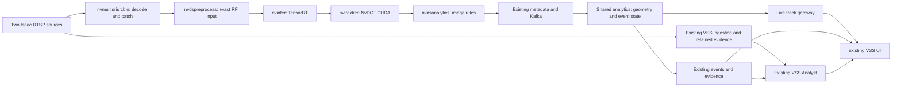

# Smart City: VSS integration research and decisions

Research completed: October 21, 2026, America/Toronto. Repository: `/home/sparkdev/vss`. Booth: Connect Tech Anvil-T5 / Jetson Thor. Development: DGX Spark GB10. Status: **implementation design; city performance is not yet measured**.

Companions: [data and calibration contracts](smart-city-data-contracts.md) and [implementation order and acceptance tests](smart-city-implementation-plan.md).

**Implementation update, October 22:** the following is the initial research/design record. Use [the implemented system](smart-city-as-built.md) for the actual HTTP/SSE architecture, Small/Medium measurements and current qualification limits. Medium has now passed a five-minute native pipeline check plus a ten-minute concurrent monitor with three real Ask/export requests and is the explicit Spark selection. Small remains the tested lower-cost baseline; final exact-preview/endurance and final-scene qualification are separate. [MV3DT has its own current decision](smart-city-mv3dt-decision.md).

## 1. Decision

Extend this VSS application with a Smart City workspace. Reuse its cameras, analysis profiles, evidence, monitoring, questions, reports and deployment guards. Add a native map component and live track feed. Isaac Sim publishes RTSP; simulation authoring is outside this work.

The first detector implementation should be **RF-DETR Small, 512 × 512, TensorRT FP16**, using the Apache-designated COCO model in `rfdetr` 1.11.2. Pair it with **DeepStream NvDCF on CUDA**. Compare RF-DETR Medium, YOLO26s/m and RT-DETRv4-M on the actual cameras before selecting the booth checkpoint. This is an initial engineering choice, not a claim that Small is universally the most accurate or fastest model.

Use **DeepStream 9.2** for the new detector worker, upgraded independently of the VLM and the rest of VSS. Use **static camera calibration and ground projection** for the map. Use **nvdsanalytics** for image-space ROI membership, counts, directional crossing and direction primitives; use shared behavior analytics for event duration, clearance and evidence. Keep Cosmos questions and explanations asynchronous.

| Job | Selected approach | Result |
| --- | --- | --- |
| Find road users | RF-DETR Small first; measured competition before freeze | Person, bicycle, motorcycle, car, bus and truck boxes |
| Follow an object in one camera | NvDCF, CUDA backend | Local identity and movement history |
| Place observations on a map | Static calibration and ground projection | Estimated positions in local metres |
| Evaluate zones and movement | Nvdsanalytics plus durable event state | Crossings, occupancy, dwell and observed queues |
| Join overlapping camera observations | Calibrated association, second phase | Fewer duplicates and cautious camera handoff |
| Explain evidence | Existing VSS Cosmos endpoint | Answer linked to a retained clip and measured facts |
| Present results | Existing React shell, new spatial workspace | Two linked cameras, map and event/evidence panel |

DS 9.2 is the current documented release. RF-DETR's tagged release and official export path support the starting choice. Neither source proves performance on our VSS workload. [DeepStream release](https://docs.nvidia.com/deepstream/text/DS_Release_notes), [RF-DETR 1.11.2](https://github.com/roboflow/rf-detr/blob/1.11.2/README.md).

## 2. Findings in your actual VSS

These are code and read-only runtime findings, not assumptions about a generic NVIDIA blueprint.

| Existing part | Finding | Consequence |
| --- | --- | --- |
| [Analysis profiles](../services/agent/packages/vss_agents/src/vss_agents/api/analysis_profiles.py) | Traffic profile advertises Bicycle, Car, Person and Road sign; permits one source. | Add a city model profile with the real taxonomy and qualified two-source admission. |
| [Smart Cities Compose](../deploy/docker/industry-profiles/smartcities/compose.yml) | Useful examples, but references older `rtvi-cv` and `developer-profiles` paths. | Port useful configuration; do not assume this profile launches unchanged. |
| [RT-CV application](../services/rtvi/rt-cv/src/metropolis_perception_app.c) | Native DeepStream app with dynamic sources, custom metadata and model-specific class handling. | Extend this adapter rather than adding an independent Python/OpenCV ingestion loop. |
| [SBSA Dockerfile](../services/rtvi/rt-cv/docker/sbsa.Dockerfile) | DS 9.1 build and prebuilt custom libraries. | DS 9.2 needs recompilation and ABI validation, not only an image-tag edit. |
| [Spark renderer](../tools/spark/bootstrap.py) | Optional detector selects a `3.2.1-sbsa` compatibility image; traffic endpoint is empty. | Source version, deployed image and target DS version are separate facts. |
| Running containers | UI, agent, VLM, ingestion, analytics and infrastructure were running; no `vss-rtvi-cv` appeared in the inspected list. | A healthy UI does not prove that structured traffic detection is running. |
| [Monitoring rule API](../services/ui/apps/nv-metropolis-bp-vss-ui/pages/api/vision/monitoring-rules.ts) | Area-entry, proximity and semantic rules; writes calibration/behavior analytics. | Extend the schema and activation path. Saving polygons does not currently configure nvdsanalytics. |
| [Region editor](../services/ui/apps/nv-metropolis-bp-vss-ui/components/vision-intelligence/MonitoringRegionEditor.tsx) | Polygon editor with fixed 1000 × 562.5 view box. | Add directed lines and actual video-content transforms for arbitrary aspect ratios. |
| [Map package](../services/ui/packages/nv-metropolis-bp-vss-ui/map/lib-src/MapComponent.tsx) | Iframe wrapper for an external map URL. | Build the required native live map in the shared UI. |
| [Cartesian calibration](../services/analytics/behavior-analytics/src/mdx/analytics/core/transform/calibration/calibration_e.py) | Homography exists; missing calibration can return pixel coordinates. Global ROI helper assumes four-point rectangles. | Reject invalid map positions; add arbitrary polygon handling. Never label pixels as metres. |
| [Older city app](../services/analytics/behavior-analytics/apps/smart_city/main_smart_city_app.py) | Cartesian setup raises `NotImplementedError`. | Extend the [composite analytics app](../services/analytics/behavior-analytics/apps/composite/main_composite_app.py). |
| [NVSchema protobuf](../services/analytics/video-analytics-api/src/web-api-core/schemas/proto/schema.proto) | Boxes, timestamps, coordinates and generic info fields exist. | Preserve Kafka compatibility; add namespaced attributes and a browser-facing view. |
| [Runtime instructions](../tools/runtime/README.md) | Saved reserves, admission and past stability failures documented. | Preserve Spark 20 GiB and Thor 10 GiB reserves. Two-camera city ingestion remains unqualified. |

The host reported **GB10, driver 580.142**. This research did not restart services, download models, build engines, change memory budgets or open simulation scenes. Existing working-tree changes were preserved.

RT-CV details to fix deliberately: `--message-rate 1` means every frame, not 1 Hz. Normal object messages use a sensor name, while the dummy/empty-frame path can use the sensor ID. Resolve both to one source UUID. Empty-frame publication is conditional on `dummy-payload`; validate that it produces a genuine empty frame, not a phantom object. Boxes are already converted from mux dimensions to original image dimensions in the current application; do not scale them twice.

## 3. What the demo can detect

| Feature | Evidence and rule | Boundary |
| --- | --- | --- |
| Road users | Six road-user classes and local tracks | COCO has no separate van or wheelchair class. Use vehicle or train a subclass later. |
| People crossing | Person crosses a directed line in the crossing region | Count once per crossing; normal crossing is not a safety alert. |
| Vehicle entry/exit | Directed line crossings by class | Camera counts are not automatically unique site counts. |
| Crosswalk/bus-stop occupancy | A relevant tracked anchor is inside a zone | Point occupancy is not precise vehicle-footprint overlap. |
| Vehicle stopped in a restricted zone | Occupancy plus low calibrated speed for a duration | Report stopped; infer parked/illegal only from explicitly configured policy. |
| Bus arrival and dwell | Bus enters stop zone, stops and later leaves | A bus behind a stopped car does not prove that the car caused a delay. |
| Queue build-up/recovery | Sustained low-speed vehicle count in a lane region | Report observed queue/wait, not city-wide congestion or signal optimization. |
| Wrong-way movement | Sustained track direction contradicts lane direction | Exclude turns and near-boundary jitter. |
| Explanation | Event facts plus retained clip | Text is asynchronous and does not overwrite measured counts. |

Keep calibrated proximity and time-to-conflict as later experiments. Near-miss claims need validated trajectories, speed uncertainty and an agreed definition. A generic traffic detector does not deliver fire, falls, collisions or identity recognition.

A clear booth sequence is normal flow → vehicle stops in a restricted zone → occupancy and dwell become an event → bus/queue state is visible → vehicle leaves → event clears → operator opens evidence or asks what happened. Each state comes from video observations, not the loop controller.

## 4. Model decision and alternatives

### First implementation and challengers

RF-DETR's tagged upstream table reports Small at **53.0 COCO AP, 512 input, 3.5 ms on T4**, and Medium at **54.7 AP, 576 input, 4.4 ms**. These publisher measurements use TensorRT FP16, batch one. They justify testing both, but do not predict Spark/Thor end-to-end FPS. [Tagged results](https://github.com/roboflow/rf-detr/blob/1.11.2/README.md).

| Candidate | Decision | Reason |
| --- | --- | --- |
| RF-DETR Small 512 | Integrate first | Strong starting accuracy/size balance; Apache-designated weights; needed classes. |
| RF-DETR Medium 576 | Mandatory quality challenger | Test whether distant pedestrian/cyclist recall gains justify cost. |
| RF-DETR Nano 384 | Capacity fallback benchmark | Lower workload; verify small-object losses. |
| RF-DETR Large 704 | Escalate if Small/Medium miss needed objects | Higher resolution and published accuracy; measure benefit first. |
| YOLO26s/m 640 | Mandatory efficiency challengers if deployment terms fit | Current tooling and official DeepStream guide; compare the same export modes. |
| RT-DETRv4-M 640 | Independent transformer challenger | Official weights/export and permissive project license. |
| Existing NVIDIA traffic RT-DETR / TrafficCamNet Transformer Lite | Integration baseline | Close to current VSS; limited class vocabulary does not deliver separate bus/truck behavior. |
| EdgeCrafter ECDet-S/M | Conditional candidate | Strong recent results; license excludes commercial use without separate terms. |
| DEIMv2, D-FINE, older RT-DETRv2 and LW-DETR | Reserve comparisons | Relevant architectures; no local evidence that they beat the shortlist. Pin exact export, weights and terms before promotion. |
| Grounding DINO / YOLOE | Optional discovery or offline labeling | Known booth classes do not require an open vocabulary in the continuous loop. |
| Segmentation / pose | Add for a measured failure | Masks or ankle points can help; neither automatically produces accurate 3D contact. |
| Learned BEV / monocular depth / 3D detector | Not in first build | Known fixed geometry provides a simpler map; street generalization/training would add work. |

YOLO26 documentation distinguishes standard and end-to-end accuracy; compare accuracy and latency for the same variant. Its DeepStream guide is implementation evidence, not certification of our DS 9.2/Thor stack. [YOLO26](https://docs.ultralytics.com/models/yolo26), [detection results](https://docs.ultralytics.com/tasks/detect), [DeepStream guide](https://docs.ultralytics.com/guides/deepstream-nvidia-jetson).

RT-DETRv4 provides an independent contender. EdgeCrafter reports strong Objects365-pretrained results; its license is a practical constraint for this company sales demo. Do not assume every publicly downloadable checkpoint permits that use. [RT-DETRv4](https://github.com/RT-DETRs/RT-DETRv4), [EdgeCrafter](https://github.com/Intellindust-AI-Lab/EdgeCrafter), [EdgeCrafter license](https://raw.githubusercontent.com/Intellindust-AI-Lab/EdgeCrafter/main/LICENSE.md), [DEIMv2](https://github.com/Intellindust-AI-Lab/DEIMv2).

The NVIDIA model card lists car, road sign, person and bicycle, so it should not be silently mapped into classes it was not trained to distinguish. [TrafficCamNet Transformer Lite](https://catalog.ngc.nvidia.com/orgs/nvidia/tao/models/trafficcamnet_transformer_lite/-).

This is a bounded current decision set, not a claim that every existing model was run. Earlier broad screening is in the Isaac workspace's `docs/research-smart-city-spark-models.md`. Current repository and local test findings take precedence over earlier integration assumptions.

### RF-DETR export and parser

Use `RFDETRSmall` from `rfdetr==1.11.2`, checkpoint `rf-detr-small.pth`, fixed 512 × 512 spatial input and a batch profile covering one and two inputs. The Medium comparison is `RFDETRMedium` with `rf-detr-medium.pth` at 576. Avoid confusing the current Large checkpoint, `rf-detr-large-2026.pth`, with the deprecated Large architecture. Capture checkpoint/ONNX hashes during implementation; none has been invented here. Build separate engines per device, TensorRT version, precision and profile. [Pinned model configuration](https://github.com/roboflow/rf-detr/blob/1.11.2/src/rfdetr/config.py).

Reproduce the official reference: RGB in 0–1, resize with the reference's `antialias=False`, channel means `[0.485, 0.456, 0.406]` and standard deviations `[0.229, 0.224, 0.225]`, normalized centre-size boxes, sigmoid logits and reference query/class selection. Match outputs by `dets`/`labels` names. Pretrained COCO slots are not a contiguous six-class list; retain the sparse layout rather than dropping the last slot as background. Do not use softmax or a generic YOLO parser. [Official ONNX postprocessing](https://rfdetr.roboflow.com/latest/exports/onnx/).

Implement a custom `nvdspreprocess` tensor-preparation path: a single `nvinfer` scale factor cannot express the three different standard deviations exactly. Feed tensors with `input-tensor-meta=1`, use a dedicated parser and validate the no-extra-clustering path (`cluster-mode=4`) against reference results. Preserve the inverse resize mapping. [Preprocessing plugin](https://docs.nvidia.com/deepstream/text/DS_plugin_gst-nvdspreprocess), [inference plugin](https://docs.nvidia.com/deepstream/text/DS_plugin_gst-nvinfer), [TensorRT export](https://rfdetr.roboflow.com/latest/exports/tensorrt/).

Map model slot → canonical road-user class → VSS compatibility type explicitly. Preserve the real class. Define vehicle grouping and rider association; person+bicycle detections do not mean two people. Start FP16; lower precision requires measured small-object and event recall, not only a hardware capability claim.

### Tracker and VLM

Start NvDCF CUDA without a ReID network. Test bus occlusion, turning, stopping and track reacquisition. Preserve the repository's CUDA tracker selection; do not reactivate its previously problematic PVA path. Track IDs remain camera/session scoped. [Tracker documentation](https://docs.nvidia.com/deepstream/text/DS_plugin_gst-nvtracker).

Keep the current Cosmos3 Nano NVFP4 endpoint for Ask and reports, but test its checkpoint and EVS configuration on city clips. The local [Nano receipt](qa/vss33-2026-10-20/cosmos3-nano-nvfp4-2026-10-21.json) reports missed brief objects under some NVFP4+EVS settings. The [Edge trial](qa/vss33-2026-10-20/cosmos3-edge-trial-2026-10-21.json) does not establish Edge as universally faster or more accurate. These limited conveyor tests are not city validation.

Give the VLM structured facts plus a short retained clip; preserve frames around the trigger. Initially admit one explanation at a time, with bounded queuing, cancellation and timeout. VLM failure must not delay the map or erase a rule event. Avoid changing VLM quantization, pruning and detector concurrency together.

## 5. DeepStream deployment and architecture

| Device | Target | Gate |
| --- | --- | --- |
| Spark | `ghcr.io/nvidia/deepstream:9.2-triton-sbsa-dgx-spark` | Check dedicated host compatibility; container deployment; no VIC, use GPU operations where required. |
| Thor / Anvil-T5 | DS 9.2 Jetson image, e.g. `ghcr.io/nvidia/deepstream:9.2-samples-multiarch`, with compatible build tooling | Check actual BSP/JetPack. Current matrix lists JP 7.2.1 / L4T 39.2, CUDA 13.2, TRT 10.16.1.7. |

Pin tested image digests. ARM64 architecture alone does not make engines or prebuilt plugin libraries portable between these devices. [Installation matrix](https://docs.nvidia.com/deepstream/text/DS_Installation), [containers](https://docs.nvidia.com/deepstream/text/DS_docker_containers).

Current Spark release notes list DGX OS 7.6.0 and driver 580.178.04; this host reports 580.142. Do not apply the DS x86 driver requirement blindly to Spark. Verify the dedicated image/host combination and run a bounded smoke test. No driver update was performed. [Spark release notes](https://docs.nvidia.com/dgx/dgx-spark/release-notes.html).

`nvmultiurisrcbin` already includes source handling and mux functionality; do not blindly add another mux. Keep the existing live/evidence path. Count all actual decoders in benchmarks rather than calling the whole stack zero-copy.

Start full-frame detection every frame, two 1080p sources, **15 FPS each as the first target; 30 FPS preferred if measured capacity allows**. These are targets. Test batch one versus two with bounded batching delay. Keep UI video at source resolution while inference uses 512/576. Do not silently skip frames to claim a headline FPS.

Extend the custom converter to carry analytics metadata while preserving VSS NVSchema protobuf; stock JSON is not a drop-in substitute. [Message conversion](https://docs.nvidia.com/deepstream/text/DS_plugin_gst-nvmsgconv).

Nvdsanalytics provides image-space ROI, direction, crossing and overcrowding. It uses bottom-centre anchors and independent stream contexts. It does not provide calibrated map fusion, all dwell semantics or durable incidents. [Analytics plugin](https://docs.nvidia.com/deepstream/text/DS_plugin_gst-nvdsanalytics).

DS 9.2 documents `POST /api/v1/analytics/reload-config` with `stream.config_file_path`. Wire and test that callback/plugin path in the actual VSS worker. Show a rule as active only after its applied revision appears in observations; a file save or HTTP response is insufficient. [REST API](https://docs.nvidia.com/deepstream/text/DS_RestServer).

New `nvmodelmux` routing and `nvinfereval` can help offline model comparisons. Keep them outside the initial critical path. In evaluation set `promotion-mode=2` (report only) and `exclude-undetected=0`; defaults otherwise allow automatic promotion or exclusion of undetected classes. Benchmark production latency without competing shadow models. [Model mux](https://docs.nvidia.com/deepstream/text/DS_plugin_gst-nvmodelmux), [inference evaluation](https://docs.nvidia.com/deepstream/text/DS_plugin_gst-nvinfereval).

NVIDIA's Thor/Spark throughput tables support feasibility screening, not our RF-DETR + VSS + VLM performance claims. Its reported settings disable rendering/OSD/tiling. [Performance methodology](https://docs.nvidia.com/deepstream/text/DS_Performance).

## 6. The top-down map

### Static plan, live observations

The scene team supplies a static site package: actor-free overhead street plan, map bounds in metres, camera calibration, valid ground regions and optional lanes/zones. Prefer a clean vector plan; an orthographic image also works. VSS receives this static package and RTSP, not the full simulator.

For each detection, estimate a ground anchor and project it onto the plan. Start with the box bottom centre; draw a symbol and short trail. Position is estimated, especially for feet hidden by crowds, truncated boxes and long vehicles. A segmentation mask does not automatically solve ground contact.

For a flat plane `Z=0`, world-to-camera rotation columns `r1`, `r2`, translation `t`, and intrinsics `K` give `H_world_to_image = K [r1 r2 t]`. Apply its inverse to undistorted image anchors. Transform other ground planes explicitly first. [Homography reference](https://docs.opencv.org/4.13.0/d9/dab/tutorial_homography.html).

Use known camera geometry plus landmark checks, or at least four non-collinear image/world correspondences with additional spread-out validation points. Declare units, axes, pose direction, image crop and distortion. Isaac camera APIs expose geometry; the companion contract specifies the handoff without implementing the simulation. [Isaac camera reference](https://docs.isaacsim.omniverse.nvidia.com/6.0.0/py/source/deprecated/isaacsim.sensors.camera/docs/index.html).

For slopes, use piecewise planes or a supplied static road mesh for ray intersection. Gaussian visuals do not automatically provide a trustworthy road collision mesh. Reject near-horizon and out-of-region projections. Missing calibration means unavailable, not guessed metres.

Do not feed live simulator actor transforms, IDs or scripted event times into the operational map/rules. They may be recorded separately for offline evaluation. The live result must come from camera pixels.

### Two-camera identity

First use camera-scoped IDs and primary coverage zones. This gives a useful two-camera map without pretending global identity is solved. Do not sum overlapping counts as unique vehicles/people. Display unresolved observations distinctly.

Then add gated association using synchronized time, class, position uncertainty, velocity and history. Keep ambiguous identities separate; nearby people are not necessarily the same person. ReID is optional supporting evidence.

NVIDIA MV3DT is a later challenger: calibrated overlapping cameras, single-view 3D tracks and inter-camera messages. Its reference is useful but not proof of street tracking for every class; a human geometry model must not be applied to buses. [MV3DT](https://docs.nvidia.com/deepstream/text/DS_MV3DT), [reference app](https://github.com/NVIDIA/DeepStream/blob/main/src/apps/reference_apps/deepstream-tracker-3d-multi-view/README.md).

### Time alignment

Boxes must match the video frame shown. Source time is different from browser receipt time. DeepStream can derive time from RTCP sender reports; system timestamp attachment instead measures mux arrival. [NTP timestamps](https://docs.nvidia.com/deepstream/text/DS_NTP_Timestamp).

Current players do not establish a shared source-clock contract with live tracks. Add it through the media gateway/presentation callbacks, or qualify an in-pipeline annotated video path. Do not place latest boxes over delayed DASH frames. The runtime notes' recent VIOS overlay-export failure also requires separate testing of annotated evidence.

Use bounded history, measured display delay and stale indicators. Interpolation may smooth short gaps but must not invent motion through long occlusions. Reconnects and clock resets create new session epochs and invalidate local IDs and pending timers safely.

## 7. Reuse across industries

Separate **workspace** (layout/vocabulary), **analysis profile** (model/capabilities), **site package** (map/cameras/rules) and **device deployment** (capacity). Keep one VSS camera and evidence system for city, warehouse and later industries.

Add a route within `VisionIntelligenceApp`; reuse camera, question, evidence and report components. Build a shared `SpatialMapView` with Canvas2D tracks and SVG/static zones. Share selected source/track/event and timeline state across panels. Two cameras do not require a separate map server or 3D renderer.

Use existing Kafka internally, shared analytics for projection/events, and a bounded live-track gateway to the browser. Redis can hold latest snapshots; existing event storage retains incidents. Do not animate through Elasticsearch polling or expose Kafka to the browser.

The right panel explains what happened and links evidence. Model details, measured latency and hardware belong in an expandable status area. Device labels must come from actual runtime identity. Preserve the approved CT AI Labs branding.

## 8. Decision boundary

Decided: extend this VSS; RF-DETR Small first; NvDCF CUDA; DS 9.2 worker; calibrated local map; explicit rule state; existing asynchronous VLM; shared industry architecture.

Still to measure: final detector size, class thresholds, small-object recall, bus/truck confusion, map error, camera association, video/overlay delay, VLM event accuracy, concurrent memory use, reconnect and sustained stability. Image digests, model hashes and camera matrices must come from actual artifacts.

Needed from the scene team: two RTSP streams with stable IDs/timing, actual image geometry, static plan and calibration, and representative clips. No simulation authoring is necessary to begin VSS contracts.

Follow the [implementation plan](smart-city-implementation-plan.md). The first complete slice should show one real tracked road user in a camera and at the right map position at the same time. Prove that before adding more event stories.
