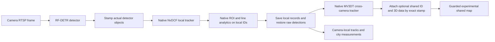

# Smart City: separate local tracking and cross-camera identity

**Historical architecture, superseded by [single native MV3DT](smart-city-native-mv3dt-2026-10-26.md).** The separate NvDCF stage described below is no longer selected by the active Spark profile.

**Earlier status: deployed on Spark, with final combined qualification pending.** The
October 26 worker uses first-stage native NvDCF for local journeys and
second-stage native MV3DT for optional guarded person-map hints. The
[native build](qa/smart-city-2026-10-26/staged-native-candidate-build.json),
[profile preparation](qa/smart-city-2026-10-26/staged-native-profile-preparation.json),
[actual local-ID observations](qa/smart-city-2026-10-26/tracking-staged-normal-60s.json)
and [association observations](qa/smart-city-2026-10-26/tracking-staged-association-60s.json)
record their separate scopes. Deployment is not proof of correct global
identities, sustained FPS or a completed AI crossing. The current
[goal ledger](smart-city-intersection-goal-2026-10-26.md) owns final acceptance.

## Why there are two tracker stages

A local journey answers: “How long did this camera track this person, and did
the person cross this line?” A shared map identity answers: “Do these two
cameras see the same person?” Those are different records.

MV3DT can change its target ID when it adopts or corrects an association with
another camera. The earlier worker used this changeable ID as its local
journey key too. A change could split a crossing or dwell observation into
short tracks. The SDK's public output provides no separate documented
pre-correction local handle. See the
[SDK identity audit](smart-city-sdk-identity-audit-2026-10-26.md).

The deployed path retains the real ID from a first native NvDCF tracker for local
journeys. A second native MV3DT tracker supplies its own cross-camera ID and
3D metadata. An application-owned stamp carries the first ID through the
second stage's **actual same-frame object association**. No box overlap,
nearest-point alias, simulation actor ID or ground-truth position creates the
link.

## What each stage owns

| Stage | Input and authority | What it does not prove |
| --- | --- | --- |
| RF-DETR | Actual current-frame detection box, class and confidence. | Persistent identity, speed, crossing or shared identity. |
| First native NvDCF | Camera-local SDK target ID and its own current local records. These records supply the local journey identity. | Identity across cameras or uninterrupted identity through every loss/occlusion. |
| Native `nvdsanalytics` | Configured camera ROI, line and direction results using first-stage local IDs. These results are saved with the local records. | Deduplicated counts across cameras. |
| Raw-detection restoration | Retains each valid first ID on the same stamped detector object; restores the original detector fields for the second tracker. | A new match between different detector objects. |
| Second native MV3DT | Its current SDK target ID, native 3D feet/visibility and cross-camera association proposal. | That every shared ID or 3D location is correct. |
| Analytics and map guards | Source/session, class, current-frame stamp, calibration, visibility, epoch, time and position checks. | City-wide globally unique counts or qualified vehicle fusion. |

The first stage's full local records are saved before the second stage can
remove or rewrite object metadata. Local analytics use those authoritative
records. A missing second-stage association therefore does not require an
invented local ID, and a changed MV3DT ID does not itself start a new local
journey. Optional shared/3D data is attached only when the second result carries
the exact current detector/local stamp. A second-stage shadow or peer-created
object without that evidence cannot acquire a local identity by inference.

Local IDs remain camera/session scoped. Keep all uint64 IDs as decimal strings
in JSON and JavaScript; the native first ID can exceed the exact integer range
of a JavaScript `Number`. A detector miss, local tracker loss, actual local ID
change, new source session or new worker epoch can still interrupt a journey.

## Observation fields in the deployed staged path

The staged path retains `city.observations.v1` and adds explicit provenance. It
does not silently redefine a native global target as the first local target.

| Field | Meaning |
| --- | --- |
| `trackingArchitecture` | `nvdcf-local-then-mv3dt-v1` identifies the staged worker path. |
| `sourceFrameId` | Original source frame number retained at PGIE output, before MV3DT can replace `frame_num`. |
| `objects[].localTrackId` | First NvDCF ID, as a decimal string. The backend scopes it by source and session. |
| `objects[].bboxPx` / `trackerConfidence` | First NvDCF box/confidence. A second tracker result does not replace the camera-local box. |
| `objects[].observedThisFrame` | True only when the first local record is linked to a current actual detector stamp. Local predictions remain unobserved. |
| `objects[].nativeAnalytics` | ROI/line/direction results saved after the first tracker and before MV3DT. |
| `objects[].globalTrackId` / `associationMethod` | Optional experimental person-map hint from the second native SDK ID. Absent evidence gives null shared identity. |
| `objects[].native3D.targetId` | The second native MV3DT ID, not the first local ID. |
| `objects[].native3D.localTargetId` | The exact first ID carried on this same current detector object. It must equal this object's `localTrackId`. |
| `objects[].native3D.localTrackingMethod` | `nvidia-nvdcf-first-stage-9.2` explicitly distinguishes the new local/global provenance contract. |
| `objects[].native3D.worldPositionM` / `imageFootPx` / `visibility` | Second-stage native outputs, subject to the existing map validity checks. |

Legacy single-tracker records still require native `targetId` to equal the
local ID. The additive staged contract permits the two IDs to differ only
with the explicit supported local method and matching `localTargetId`.
Declaring two arbitrary strings is not accepted as association evidence.

## Metadata provenance and isolation

The source implementation is in
`services/rtvi/rt-cv/smart-city/src/staged_tracking.hpp`, integrated by
`src/city_worker.cpp`. Its focused native metadata tests are in
`tests/test_staged_tracking.cpp`.

The application uses two registered metadata descriptors:

- `VSS.CITY.STAGED_FRAME.V1` retains the current frame token, original source
  frame number, source/pad identity, PTS and NTP.
- `VSS.CITY.STAGED_DETECTION.V1` retains the actual detector fields and the
  first native local ID after that stage confirms the same current object.

The frame token is separate from final `frame_num`: MV3DT can replace that SDK
field with its internal batch counter. A current detector stamp must agree
with the preserved frame identity, not with a guessed final frame number.
User metadata has explicit deep-copy and release functions. Reserved SDK bytes
and metadata-pool addresses are not identity handles.

Between tracker stages, remove only the first tracker's batch past-frame,
batch ReID, terminated-track and shadow-track metadata. Preserve PGIE tensor,
preprocessing, source clocks and unrelated metadata. The first stage must not
leave 3D/projection fields that could be read as the second stage's output.
The second native tracker is the 3D authority; the first native tracker is the
local identity authority.

An independent actual `libnvds_meta` CPU proof passed: object metadata deep
copies are independent, new objects have no inherited application stamp, the
four tracker batch types can be removed without removing PGIE/unrelated
metadata, and all **9 payload allocations / 9 releases** balance. Its receipt
is under
`.spark/city/runtime/intersection-rebuild-20261026/sdk-user-meta-proof/`.
This is metadata API validation, not GPU tracker or identity validation.

## Deployment and limits

The deployed path uses the existing `--tracker-mode mv3dt-demo` plus an explicit
`--local-tracker-config FILE`. With that argument absent, the legacy single
tracker behavior remains supported and unchanged. Root owns the immutable
profile snapshot, image selection, source-scoped pause/cutover and rollback. No Kit scene,
camera geometry, detector model or traffic signal change is required for this
architecture.

Cross-camera person map associations remain experimental and retain their
existing guards. Vehicle observations remain camera-local until separately
qualified. No ground-truth data enters operational RTSP, inference, local
journeys, counts, shared IDs or map associations. Separate read-only evaluation
captures may compare results with simulator ground truth; they do not feed it
back into analytics.

Two native trackers add compute and metadata work. Actual FPS, preview age,
local ID continuity, observed coverage, local crossing/dwell results and map
association behavior need their own acceptance evidence. Final mux settings
and combined performance remain under review. No performance gain is claimed.
The earlier two-switch “stable local IDs” trial is a separate historical
experiment; it must not be confused with the deployed separation of first-stage
local and second-stage cross-camera identity.
